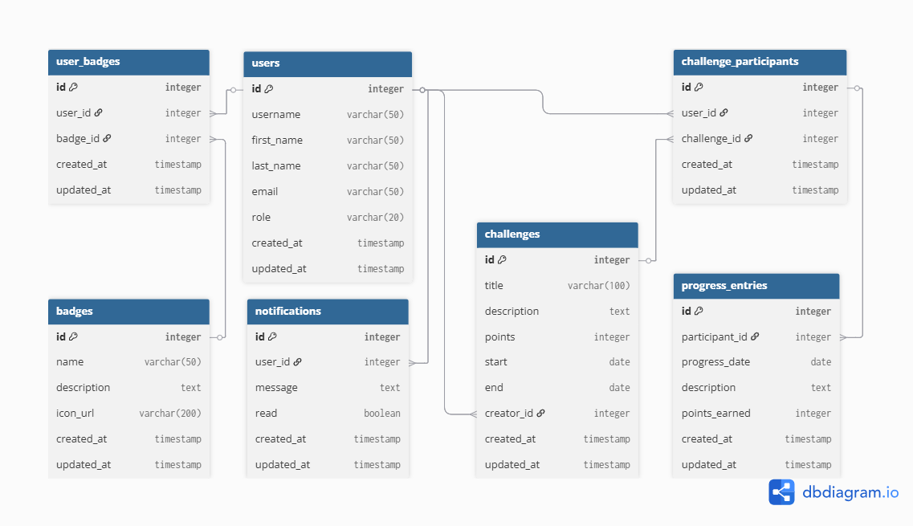

# FitChallenge

Web app where users create fitness challenges, join them, log their progress and earn badges. Built with Ruby on Rails 8 as an individual project for the Web Technologies course at Universidad de los Andes (Chile).

## Features

- **Authentication** with Devise: sign up, log in, password recovery.
- **Role-based authorization** with CanCanCan:
  - Admins manage everything.
  - Logged-in users can create challenges and edit or delete only their own.
  - Visitors can browse challenges and badges.
- **Challenges** with points, start and end dates, and a creator.
- **Participants** that join a challenge and log **progress entries** with points earned.
- **Badges** awarded to users, plus per-user **notifications**.
- Responsive UI with Bootstrap and a shared navbar.

## Tech stack

Ruby 3.4.5 · Rails 8.0 · PostgreSQL · Devise · CanCanCan · Bootstrap · Hotwire (Turbo + Stimulus)

## Data model



Main entities: `User`, `Challenge`, `ChallengeParticipant`, `ProgressEntry`, `Badge`, `UserBadge`, `Notification`.

The user stories that guided the design are in [docs/user-stories.md](docs/user-stories.md).

## Running locally

Requirements: Ruby 3.4.5, Bundler and a local PostgreSQL server.

```bash
cd fitChallenge
bundle install
bin/rails db:create db:migrate db:seed
bin/rails server
```

Open http://localhost:3000.

The seed data creates a local admin account: `admin1@gmail.com` / `admin1234`.

## Project structure

```
.
├── docs/            # user stories and data model diagrams
└── fitChallenge/    # Rails application
    ├── app/models/      # domain models and CanCanCan Ability
    ├── app/controllers/ # one controller per resource
    ├── app/views/       # ERB + Bootstrap views (including customized Devise views)
    └── db/              # migrations, schema and seeds
```
